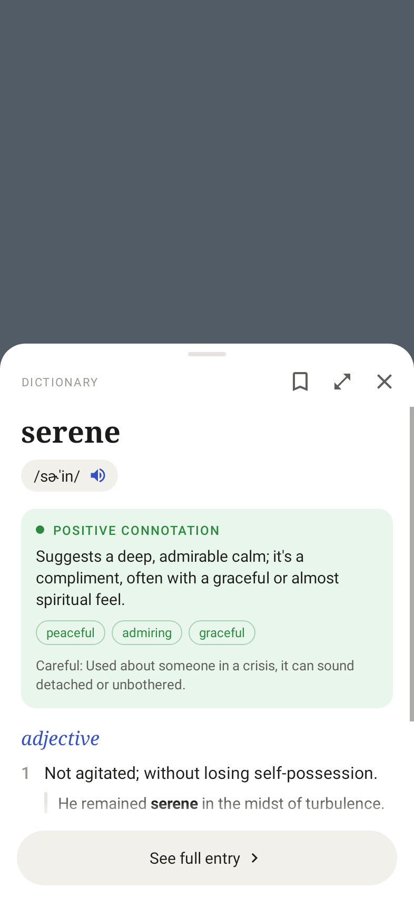
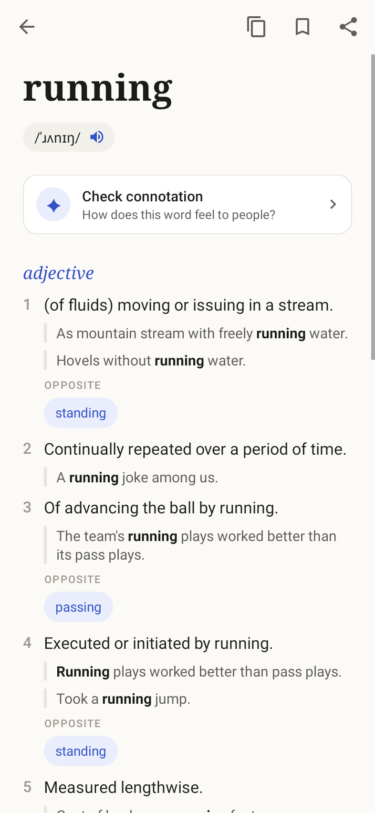
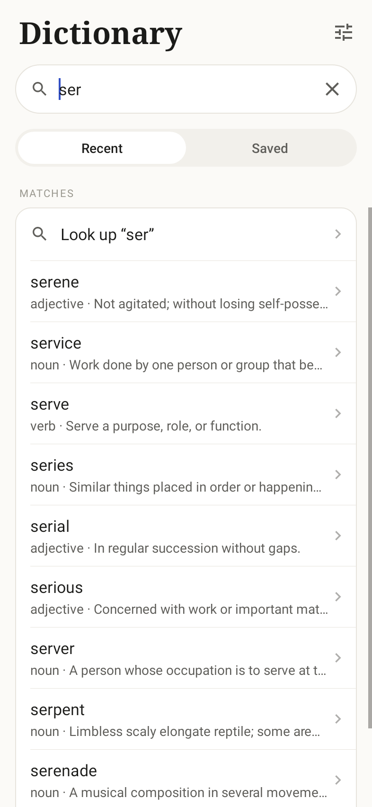
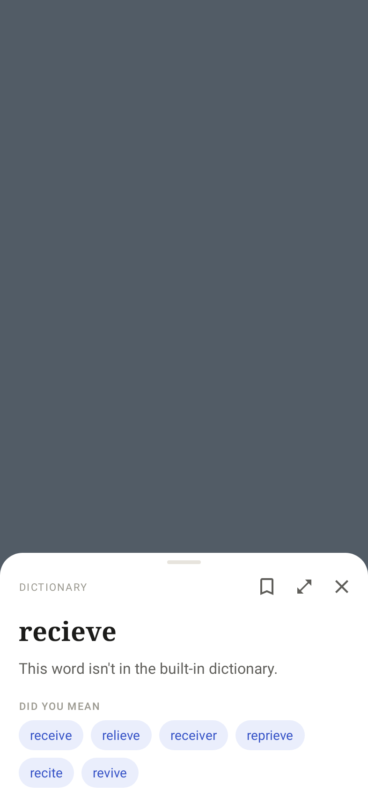

# ColorDict

A clean English dictionary for Android with a quick-lookup popup.

- **Built-in dictionary.** About 150,000 English words with pronunciations,
  numbered meanings, examples, synonyms and antonyms, all inside the app.
  Lookups are instant, offline and free.
- **Connotation when you want it.** Tap **Check connotation** on any word and
  Claude explains how it feels to people, using your own Anthropic API key.
  The answer is saved with the word, so next time it's already there.
- **Words the dictionary lacks** (slang, new words, names) get a **Look up
  with Claude** button for the meaning and connotation, also saved.

| Popup with saved connotation | Word page | Search as you type | Misspelling |
|---|---|---|---|
|  |  |  |  |

## How it works

- **Definitions** come from a SQLite database bundled in the APK
  (`app/src/main/assets/dictionary.db.gz`, built from Open English WordNet 2024
  and the CMU Pronouncing Dictionary; see [NOTICE.md](NOTICE.md)). It is
  copied out of the APK on first launch (a few seconds), then every lookup
  reads it directly. Inflected forms find their base word ("geese" → goose,
  "ran" → run, "cities" → city), and misspellings get "Did you mean"
  suggestions.
- **Connotation** is the only thing that uses the network. Paste an Anthropic
  API key in **Settings → API key**
  ([get one](https://platform.claude.com/settings/keys)). Tapping **Check
  connotation** sends that word and its dictionary meanings to Claude through
  the official [Claude Java SDK](https://github.com/anthropics/anthropic-sdk-java)
  and gets back the tone, a short explanation, a few descriptors and when the
  word can come across differently. It's saved on the phone per word, so each
  word costs one request, once. The key stays on the device and is excluded
  from backups.
- **Model choice** (Settings): Claude Opus 5.5 (default), Sonnet 5.5, or
  Haiku 5.5 (fastest and cheapest).

## The popup

Select text in any app and tap **Define**, or share text to ColorDict, and a
bottom sheet opens over what you're reading with the top of the entry. Swipe
up and the sheet rises until fully open, then the entry scrolls, in one
continuous gesture; swipe down and the entry scrolls back to its top, then the
sheet lowers to its short position, and another swipe down closes it. Tap a synonym to look it up in place, or "See
full entry" at the end to open the word page.

E-book readers that support the classic ColorDict lookup intent keep working:

```java
Intent intent = new Intent("colordict.intent.action.SEARCH");
intent.putExtra("EXTRA_QUERY", "serene");
// optional
intent.putExtra("EXTRA_FULLSCREEN", false);       // true opens the full entry
intent.putExtra("EXTRA_GRAVITY", Gravity.BOTTOM); // TOP / CENTER float as a card
intent.putExtra("EXTRA_WIDTH", widthPx);
intent.putExtra("EXTRA_HEIGHT", heightPx);
intent.putExtra("EXTRA_MARGIN_BOTTOM", marginPx); // also _LEFT, _TOP, _RIGHT
startActivity(intent);
```

## Install

Grab the debug APK from the
[Releases page](https://github.com/roviicc/colordict/releases) (pushing a
`v*` tag builds one) or from any CI run's artifacts. Android 8.0+.

## Development

```bash
./gradlew test assembleDebug                 # JDK 17+, Android SDK 35
python3 tools/build_dictionary.py --fetch    # rebuild the dictionary database
```

```
tools/build_dictionary.py        WordNet + CMUdict → assets/dictionary.db.gz
app/src/main/java/io/github/roviicc/colordict/
  App.java                       creates Settings and DictionaryRepository once
  data/
    DictionaryRepository.java    what screens call: lookups, suggestions, connotations, word lists
    Entry.java                   a dictionary entry (+ optional connotation)
    LookupError.java             user-facing error + the fix to offer (retry / settings)
    Settings.java, WordList.java theme, API key, model; Recent and Saved lists
    dictionary/                  offline dictionary (SQLite), base forms, spelling suggestions
    claude/                      Claude requests (connotations, meanings of missing words) and saved answers
  ui/
    MainActivity, WordActivity, PopupActivity, SettingsActivity   the four screens
    entry/                       the word view: EntryController (shared by the word page and
                                 popup), EntryRenderer, ClaudeSlot
    widget/                      small reusable views and helpers (CardList, FlowLayout, ...)
```

Feature ideas from a Mobbin survey of dictionary and vocabulary apps are in
[docs/feature-ideas.md](docs/feature-ideas.md).

## License

Code: [MIT](LICENSE). Dictionary data: Open English WordNet (CC BY 4.0) and
the CMU Pronouncing Dictionary (BSD); see [NOTICE.md](NOTICE.md).
