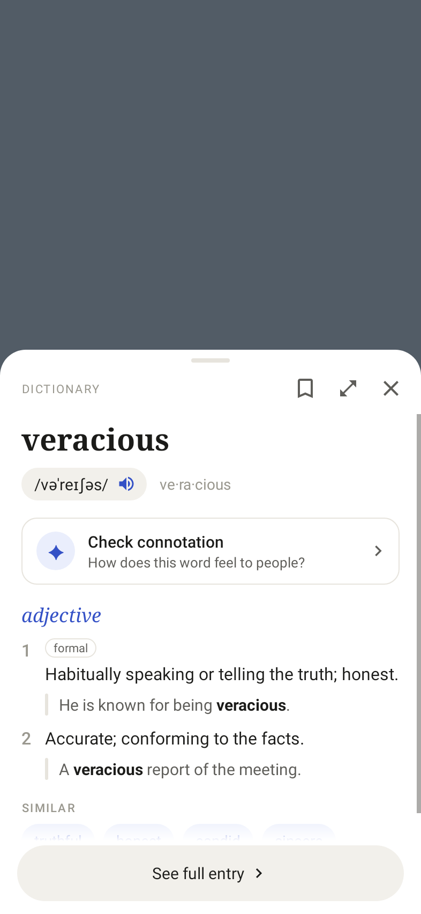
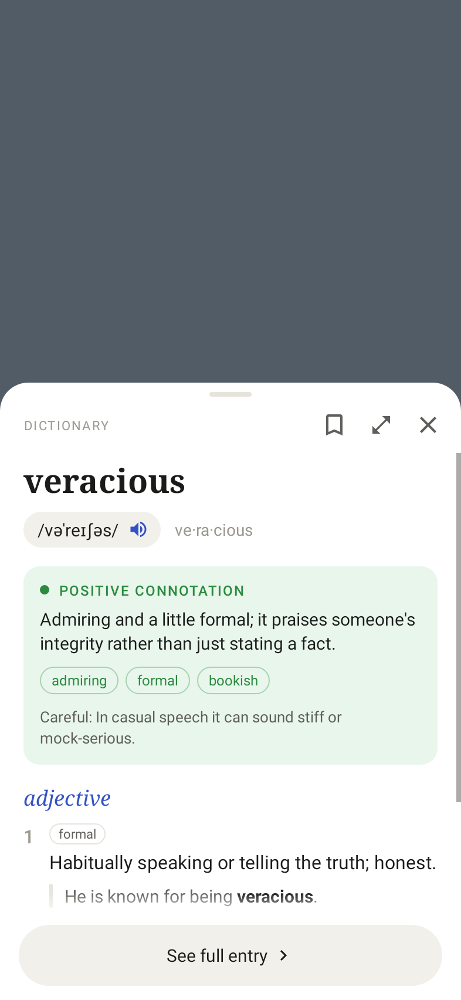
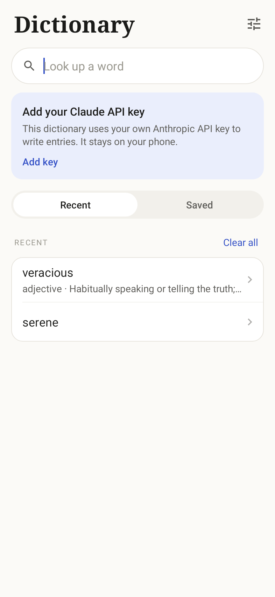

# ColorDict

A clean English dictionary for Android with a quick-lookup popup. Entries
(pronunciation, meanings, examples, synonyms, origin) are written by Claude
using **your own Anthropic API key**. Connotation is on demand: tap **Check
connotation** once and it's saved with the word, so it shows automatically
every time after that.

| Popup | After "Check connotation" | First run | Dark |
|---|---|---|---|
|  |  |  |  |

## How it works

- **Bring your own key.** Paste an Anthropic API key in **Settings → API
  key** ([get one](https://platform.claude.com/settings/keys)). The app calls
  the Claude API directly from the phone with the official
  [Claude Java SDK](https://github.com/anthropics/anthropic-sdk-java). There
  is no app server. The key is stored only on the device and is excluded from
  Android backups and device transfers. Lookups are billed to your own
  account.
- **One request per new word.** The first lookup asks Claude for the entry
  using structured outputs, so the reply always matches a fixed JSON schema.
  The entry is saved on the phone, so opening the word again is instant, free
  and works offline.
- **Connotation on request.** Connotation is a separate, smaller request
  that runs only when you tap **Check connotation**. The answer (overall tone,
  a short explanation, a few descriptors, and when the word can come across
  differently) is saved into that word's entry. From then on it appears
  automatically and the button is gone.
- **Model choice.** In Settings: Claude Opus 5.5 (default, best entries),
  Sonnet 5.5, or Haiku 5.5 (fastest and cheapest). Requests use low effort to
  keep lookups quick. On Opus and Sonnet, policy declines are retried on
  Anthropic's recommended fallback model.

## The popup

Select text in any app and tap **Define**, or share text to ColorDict, and a
bottom sheet opens over what you're reading. Tap a synonym to look it up in
place, tap the expand icon for the full entry, and swipe down to close.

E-book readers that support the classic ColorDict lookup intent keep working:

```java
Intent intent = new Intent("colordict.intent.action.SEARCH");
intent.putExtra("EXTRA_QUERY", "serene");
// optional
intent.putExtra("EXTRA_FULLSCREEN", false);       // true opens the full entry
intent.putExtra("EXTRA_GRAVITY", Gravity.BOTTOM); // TOP / CENTER float as a card
intent.putExtra("EXTRA_WIDTH", widthPx);
intent.putExtra("EXTRA_HEIGHT", heightPx);
intent.putExtra("EXTRA_MARGIN_BOTTOM", marginPx); // also _LEFT, _TOP, _RIGHT
startActivity(intent);
```

## Install

Grab the debug APK from the
[Releases page](https://github.com/roviicc/colordict/releases) (pushing a
`v*` tag builds one) or from any CI run's artifacts. Android 8.0+.

## Development

```bash
./gradlew test assembleDebug   # JDK 17+, Android SDK 35
```

```
app/src/main/java/io/github/roviicc/colordict/
  data/ClaudeDictionary   Claude API calls: prompts, JSON schemas, error mapping
  data/Dictionary         settings (key, model), lookups, save-once connotation
  data/Entry, EntryStore  entry model and on-device storage
  ui/                     Home, Word, Popup and Settings screens; EntryRenderer
                          draws the word view shared by the page and the popup
```

`ClaudeDictionaryTest` runs the real SDK client against a local fake of the
Messages API, so request shape, parsing and error handling are tested without
a key.

## License

[MIT](LICENSE). Dictionary entries are generated by Claude and can contain
mistakes.
