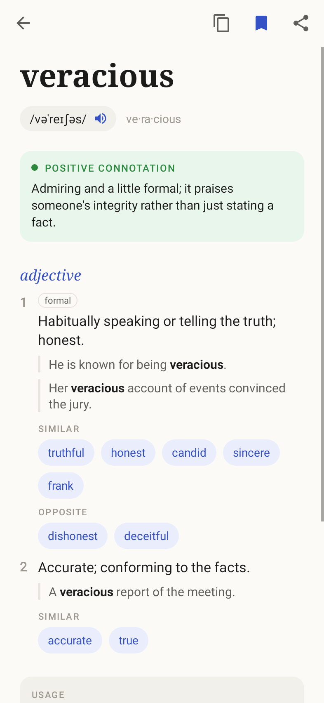
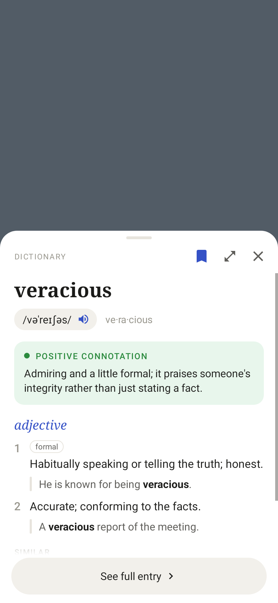
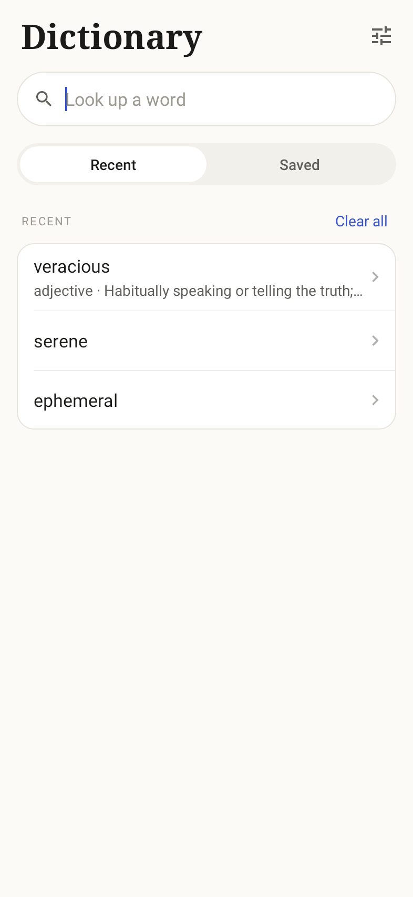

# ColorDict

A clean English dictionary for Android with a quick-lookup popup. Every entry
(pronunciation, meanings, examples, synonyms, **connotation**, origin) is
written on demand by Claude through a small server you deploy yourself, then
kept on the phone so words open instantly and work offline the next time.

| Word | Popup | Home | Dark |
|---|---|---|---|
|  |  |  |  |

## How it fits together

```
Android app ──GET /api/define?word=serene──▶ Vercel function ──▶ Claude API
     ▲                                         (api/define.ts)
     └───────────── JSON dictionary entry ◀────────┘
```

- **`api/define.ts`** is a single serverless function. It asks Claude for one
  entry using structured outputs, so the reply always matches a fixed JSON
  schema, and Vercel's CDN caches each word for 30 days. Your Anthropic API
  key stays on the server; it is never in the APK.
- **`app/`** is the Android app: plain Java with no libraries (the APK is
  under 100 KB).

## 1. Deploy the dictionary server

1. Import this repository in [Vercel](https://vercel.com/new). The defaults
   work: no build command and no root directory to set.
2. Under **Settings → Environment Variables**, add:

   | Variable | Required | Value |
   |---|---|---|
   | `ANTHROPIC_API_KEY` | yes | Your key from the [Claude Console](https://platform.claude.com/) |
   | `CLAUDE_MODEL` | no | Model ID, default `claude-opus-5-5` |
   | `CLAUDE_EFFORT` | no | `low` (default), `medium` or `high`. Lower is faster and cheaper |
   | `APP_TOKEN` | no | Any random string. The app must send the same value (see below) |

3. Redeploy, then open `https://<your-app>.vercel.app/api/define?word=serene`.
   You should get a JSON entry back.

Opus is the default for entry quality. For faster, much cheaper lookups set
`CLAUDE_MODEL=claude-haiku-5-5`. Policy declines are retried on Anthropic's
recommended fallback model (`fallbacks: "default"`).

The endpoint is public, so put a spend limit on your Anthropic key. You can
also turn on Vercel's firewall rate limiting for `/api/define`. `APP_TOKEN`
keeps casual callers out, but anyone who unpacks the APK can read it.

## 2. Build the app with your server address

```bash
./gradlew assembleDebug -PdictApiUrl=https://<your-app>.vercel.app
# optional, if you set APP_TOKEN on the server:
#   -PdictAppToken=<same value>
```

The APK is written to `app/build/outputs/apk/debug/`. The address can also be
set later in the app under **Settings → Server address**.

For CI-built APKs (GitHub Actions and tagged releases), add a repository
variable `DICT_API_URL` under **Settings → Secrets and variables → Actions →
Variables**. Push a `v*` tag to publish a release with installable APKs.

## The popup

Select text in any app and tap **Define**, or share text to ColorDict, and a
bottom sheet opens over what you're reading. Tap a synonym to look it up in
place, tap the expand icon for the full entry, and swipe down to close.

E-book readers that support the classic ColorDict lookup intent keep working:

```java
Intent intent = new Intent("colordict.intent.action.SEARCH");
intent.putExtra("EXTRA_QUERY", "serene");
// optional
intent.putExtra("EXTRA_FULLSCREEN", false);       // true opens the full entry
intent.putExtra("EXTRA_GRAVITY", Gravity.BOTTOM); // TOP / CENTER float as a card
intent.putExtra("EXTRA_WIDTH", widthPx);
intent.putExtra("EXTRA_HEIGHT", heightPx);
intent.putExtra("EXTRA_MARGIN_BOTTOM", marginPx); // also _LEFT, _TOP, _RIGHT
startActivity(intent);
```

## Development

```bash
npm install && npm run typecheck && npm test   # server
./gradlew test assembleDebug                    # app (JDK 17+, Android SDK 35)
```

```
api/define.ts        serverless function: validation, prompt, schema, caching
test/                server tests (node --test)
app/src/main/java/io/github/roviicc/colordict/
  data/              Entry model, HTTP client, on-device entry cache, word lists
  ui/                Home, Word, Popup and Settings screens; EntryRenderer
                     draws the word view shared by the page and the popup
```

## License

[MIT](LICENSE). Dictionary entries are generated by Claude and can contain
mistakes.
